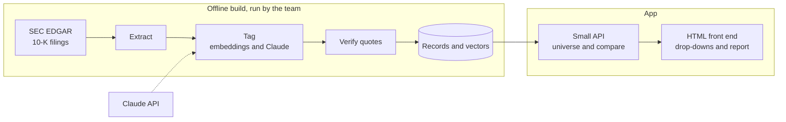

# Risk Factor Gap Finder

A web app and Claude skill that compares a company's 10-K risk factors with those of peers you choose. It answers two questions: which risk topics do most peers disclose that the company does not, and which topics did peers add this year?

It covers Fortune 500 companies in two separate pools, technology and energy. It is a research aid, not a compliance tool. Peer disclosure is evidence of what comparable companies chose to say, not a legal standard, so every flag is a "candidate for counsel review."

**Status:** Draft. Spec v0.7 written, build not started.

## What it does

Pick a pool, a target, and at least five peers from drop-downs. The report shows:

| Output | What it shows |
|---|---|
| Gap flags | Topics most selected peers disclose in FY2025 that the target has no matching risk factor for |
| Trend flags | Topics selected peers added in FY2025 that the target lacks |
| No flag | Topics the target already covers |
| Target-only topics | Topics the target discloses that no selected peer does |

Every flag quotes peer language verbatim and cites the filing. A script checks the quotes, and every count prints with its denominator, such as "5 of 8 peers."

## The problem it solves

One risk factor section runs roughly 15,000 to 30,000 tokens, so ten peers across two years is too much text for any single pass. The build works in two stages instead: turn each filing into compact records (topic, quote), then compare the records. A script handles all counting.

## How it works



1. **Extract.** A script pulls Item 1A from each 10-K. The table of contents also says "Item 1A," so the script takes the longest span between Item 1A and Item 1B.
2. **Tag.** Each risk factor is mapped to a topic from a fixed list of 30 to 40, with a one-line verbatim quote. Embeddings pre-label the easy cases and Claude settles the rest. Headings come first, and body text is read only when a heading is ambiguous.
3. **Compare.** A script computes prevalence by topic and year, the trend sets, and the target's coverage.
4. **Report.** A fixed template fills in the results.

All Claude calls happen in the offline build, so the app itself makes none.

## Using the app (planned)

1. Pick a pool, technology or energy.
2. Pick the target from the drop-down.
3. Pick peers from the multi-select drop-down. It lists only companies already ingested in that pool, so every peer has a processed filing. No free text. Five peers is the minimum.
4. Read the report. The peer set and thresholds print in the header.
5. Check the sensitivity table to see which flags disappear if you drop any one peer.

The app works on filed, public documents only. There are no uploads.

## Layout (planned)

```
risk-factor-gap-finder/
├── SKILL.md                 Claude skill instructions (offline and notebook use)
├── Spec.md                  specification for build 1
├── references/              taxonomy, universe, config
├── scripts/                 extract, verify quotes, compare
├── templates/gap-report.md  fixed report format
├── backend/                 small API
├── web/                     static HTML front end
├── docs/                    diagrams and earlier spec versions
├── data/                    raw, extracted, records
└── eval/                    labeled samples, scored runs, error log
```

## Rules the system follows

- Every flag quotes peer language and cites the filing.
- Quotes are verbatim. A script checks.
- Never "required." Always "a candidate for counsel review."
- Gap flags and trend flags are reported separately.
- Topics the target already covers get a "no flag" line.
- Risk factors that fit no topic are listed as taxonomy candidates, never forced into one.

## Known limits

- Peer disclosure is not a legal standard. A company can reasonably decline to match its peers.
- Peer choice drives results. The app shows the peer set and how sensitive the flags are to it.
- Materiality is specific to each company, and the tool knows nothing about the target's facts.
- The topic list is only as good as its authors and its legal review.
- Mixed subsectors produce misleading gaps, so the two pools stay separate.
- Extraction can fail on unusual filings. Failures are reviewed by hand, never guessed.

## Testing

Test design is in active development. `Spec.md` Section 10 lists component checks only.

## Build status

Nothing is built yet. The spec is the only artifact. Its open questions (deadline, legal reviewer, seed universe size, hosting, embedding model, ownership) are in Section 13.

## Disclaimer

Research aid only. Not legal advice. Output should be reviewed by qualified counsel before anyone relies on it.
