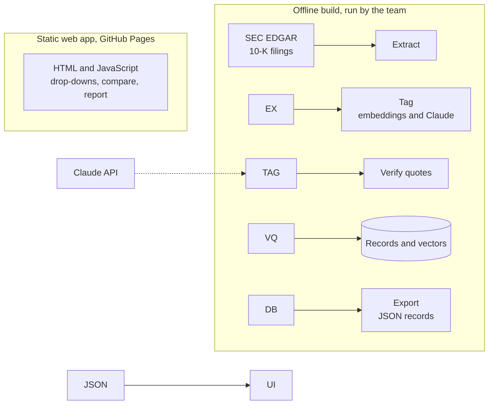

# Risk Factor Gap Finder

A web app and Claude skill that compares a company's 10-K risk factors with those of peers you choose. It answers two questions: which risk topics do most peers disclose that the company does not, and which topics did peers add this year?

It covers S\&P 500 companies in two separate pools, energy and information technology, defined by GICS sector. It is a research aid, not a compliance tool. Peer disclosure is evidence of what comparable companies chose to say, not a legal standard, so every flag is a "candidate for counsel review."

**Status:** Draft. Spec v0.7 written, build not started.

## The problem it solves

Every year, a public company must update the risk factors in Item 1A of its 10-K. Regulation S-K Item 105 requires disclosure of the material factors that make an investment speculative or risky. Counsel typically pulls last year's risk factors, reads what peers disclosed in their new filings, identifies risks that are new or missing, then drafts and reviews the update.

The reading and comparison step is the bottleneck. A single risk factor section can run dozens of pages, and a careful refresh compares ten or more peers across two years. Missing or stale risk factors can draw SEC comment letters and support securities claims. This tool automates the reading and comparing. Lawyers keep every judgment about what to disclose.

**Intended users:** capital markets associates and in-house securities counsel preparing an annual 10-K. A supervising lawyer decides which flags, if any, become disclosure.

## Scope and phasing

Both sector pools and the web app are core. They are built in sequence: energy end to end first, then technology, so the pipeline is proven on one pool before it is reused on the second.

|Phase|Weeks|Deliverable|
|-|-|-|
|1|1–2|Energy: extraction, shared and energy taxonomy, tagging, JSON records, basic static app|
|2|2–3|Energy backtest and fixes; start tech ingestion and the tech taxonomy module|
|3|3–4|Tech backtest, app feature freeze, final scored runs, memos|

* **Filings:** 10-K Item 1A, FY2023 to FY2025, for both pools.
* **Record format first:** the JSON schema for records is fixed in week 1, so the app can be built in parallel with the pipeline.
* **App freeze:** the app is feature-frozen at the start of phase 3 so the final week goes to testing.
* **If time runs short:** the tech evaluation uses fewer labeled targets, and the memo says plainly that tech reliability claims rest on less evidence than energy's.
* **Stretch:** additional years for a second backtest; more sectors.

## What it does

Pick a pool, a target, and at least five peers from drop-downs. The report shows:

|Output|What it shows|
|-|-|
|Gap flags|Topics most selected peers disclose in the as-of year that the target has no matching risk factor for|
|Trend flags|Topics selected peers added in the as-of year that the target lacks|
|No flag|Topics the target already covers|
|Target-only topics|Topics the target discloses that no selected peer does|

Every flag quotes peer language verbatim and cites the filing by EDGAR accession number and URL. A script checks the quotes, and every count prints with its denominator, such as "5 of 8 peers."

### Definitions and thresholds

All thresholds live in `references/config` and print in every report header.

* **As-of year.** The report runs for a chosen fiscal year (default FY2025). It is a parameter, not hard-coded, so the backtest can run as of FY2024.
* **Fiscal year matching.** Peers' fiscal years end on different dates, especially in tech. A company's "FY" filing is the latest 10-K it filed in the corresponding calendar year, so cross-peer comparisons may cover slightly different periods.
* **Gap.** A topic disclosed by more than half of the selected peers (default threshold) and not by the target.
* **Trend.** A topic present in a peer's as-of-year 10-K and absent from that peer's prior-year 10-K, for at least two selected peers (default threshold).
* **Added vs. reworded.** A risk factor counts as added only if its topic is new for that company. A reworded risk factor on an existing topic is not a trend.
* **Matching.** A target risk factor "matches" a topic when it is tagged to that topic. The embedding similarity cutoff used in pre-labeling is a tested parameter (see Testing).

## How it works

Ten peers across two years is too much text for any single pass, since one risk factor section runs roughly 15,000 to 30,000 tokens. The build works in two stages instead: turn each filing into compact records (topic, quote), then compare the records. A script handles all counting.



1. **Extract.** A script pulls Item 1A from each 10-K. The table of contents also says "Item 1A," so the script takes the longest span between Item 1A and Item 1B, falling back to Item 2 when Item 1B is missing. Filings with no Item 1A are logged, not guessed. Filings are downloaded from EDGAR in their original HTML, because the bold and italic headings are needed to split individual risk factors.
2. **Tag.** Each risk factor is mapped to a topic from a fixed list of 30 to 40, with a one-line verbatim quote. Embeddings pre-label the easy cases and Claude settles the rest. Headings come first, and body text is read only when a heading is ambiguous.
3. **Compare.** A script computes prevalence by topic and year, the trend sets, and the target's coverage. The app runs the same logic in the browser.
4. **Report.** A fixed template fills in the results.

All Claude calls happen in the offline build, so the app itself makes none. Because the app only filters and counts precomputed records, it needs no backend: it is a static HTML and JavaScript page that loads the exported JSON, hosted free on GitHub Pages, with no server, API keys, or hosting cost. The command-line compare script produces the identical report and is what the backtest uses, and a check confirms the two give the same output.

### How the taxonomy is built

The topic list has two layers: a **shared core** of topics that apply across sectors (cybersecurity, key personnel, macroeconomic conditions, general regulation) and a **sector module** for each pool (commodity prices and well operations for energy, for example, or chip supply chains and AI for technology). Clustering both pools together shows which topics are shared.

The topic list is drafted from the data, then reviewed by people:

1. Split every risk factor in the pool's filings and embed it with a pretrained sentence-embedding model.
2. Cluster the embeddings with k-means, testing a range of cluster counts and recording the choice.
3. Have Claude propose a name and definition for each cluster from the headings nearest its center.
4. The team merges, splits, and renames clusters, adds detection cues and synonyms, and has the list legally reviewed.

The final list is frozen before the backtest so that test results are not tuned to the answer key.

## Using the app (planned)

1. Pick a pool, energy or technology.
2. Pick the target from the drop-down.
3. Pick peers from the multi-select drop-down. It lists only companies already ingested in that pool, so every peer has a processed filing. No free text. Five peers is the minimum.
4. Read the report. The peer set, as-of year, and thresholds print in the header.
5. Check the sensitivity table to see which flags disappear if you drop any one peer.

The app works on filed, public documents only. There are no uploads. The same report can also be produced by running the compare script with a target, peer list, and as-of year.

## Layout (planned)

```
risk-factor-gap-finder/
├── SKILL.md                 Claude skill instructions (offline and notebook use)
├── Spec.md                  specification for build 1
├── references/              taxonomy, universe, config
├── scripts/                 extract, verify quotes, compare
├── templates/gap-report.md  fixed report format
├── web/                     static HTML and JavaScript app (GitHub Pages)
├── docs/                    diagrams and earlier spec versions
├── data/                    raw, extracted, records, exported JSON
└── eval/                    labeled samples, scored runs, error log
```

## Rules the system follows

* Every flag quotes peer language and cites the filing by accession number and URL.
* Quotes are verbatim. A script checks.
* Never "required." Always "a candidate for counsel review."
* Gap flags and trend flags are reported separately.
* Topics the target already covers get a "no flag" line.
* Risk factors that fit no topic are listed as taxonomy candidates, never forced into one.
* Every count prints with its denominator, and every report prints its peer set, as-of year, and thresholds.

## Testing

Every reliability claim in the memo must trace to a result in `eval/`.

**Backtest (primary test).** Run the tool as of FY2024 for each target in a pool, then compare its flags against the topics the target actually added in its FY2025 10-K. Energy is tested first. The technology backtest then serves as a test of whether the tool generalizes to a second sector, and results are reported separately for each pool.

* **Answer key.** The team hand-labels, for each target, the risk factor topics added between FY2024 and FY2025, starting from a comparison of the two years' risk factor headings. Two team members label each filing independently, and their agreement rate is recorded.
* **Recall.** Of the topics the target actually added, how many did the tool flag?
* **Precision.** Of the flags raised, how many matched a real addition? Unmatched flags are reviewed by hand, since a company may reasonably decline to add a risk.
* **SEC comment letters.** Where SEC staff asked a company in the pool to add or expand a risk factor, did the tool flag that topic?

**Component tests.**

* **Extraction.** Every extracted Item 1A is spot-checked against the filing for missing or extra risk factors. Failures are logged by cause.
* **Tagging accuracy.** Tool tags are compared against hand labels on a sample of risk factors, reported by topic.
* **Similarity threshold.** The embedding cutoff is tested at several values, and the recall and false-flag rate at each are reported.
* **Quote verification.** The checker is tested on deliberately altered quotes to confirm it catches them.
* **Peer sensitivity.** Results are re-run with one peer dropped at a time.
* **App consistency.** The app's report is compared against the compare script's output for the same inputs.

**Process.** Each change to the taxonomy, prompts, or thresholds is re-tested and logged in the lab notebook with before and after scores. The taxonomy and thresholds are frozen before the final backtest run. `Spec.md` Section 10 holds the component check details.

## Known limits

* Peer disclosure is not a legal standard. A company can reasonably decline to match its peers.
* Peer choice drives results. The app shows the peer set and how sensitive the flags are to it.
* Materiality is specific to each company, and the tool knows nothing about the target's facts.
* The topic list is only as good as its authors and its legal review.
* Mixed subsectors produce misleading gaps, so the two pools stay separate.
* Extraction can fail on unusual filings. Failures are reviewed by hand, never guessed.
* Tagging can be wrong. Embeddings and Claude can assign a risk factor to the wrong topic or miss one; measured error rates are in `eval/`.
* Hindsight leakage. Claude may already know about events after the as-of year, which could inflate backtest scores. Every flag must cite a peer filing from the as-of year, and this limit is reported with the results.
* Fiscal years differ across companies, so "the same year" can cover different periods.
* Results apply only to the ingested universe. Companies outside the pools cannot be peers.
* Evidence may be uneven across pools. If the tech evaluation is smaller, its reliability claims are weaker, and reports say which pool's results they rest on.

## Build status

Nothing is built yet. The spec is the only artifact. Its open questions (deadline, legal reviewer, seed universe size, embedding model, ownership) are in Section 13. Hosting is proposed as GitHub Pages, pending team confirmation.

## Disclaimer

Research aid only. Not legal advice. Output should be reviewed by qualified counsel before anyone relies on it.

